# 疫情网课管理系统

> 🎓 **计算机毕业设计 · 疫情网课管理系统**
>
> 本仓库只放**项目介绍 + 运行截图**（截图是站点带水印的原图，存在仓库 `images/` 里）。
>
> 👉 **完整可运行源码 / 数据库脚本 / 部署文档：[点我获取](https://geekcode.top/archives/%E7%96%AB%E6%83%85%E7%BD%91%E8%AF%BE%E7%AE%A1%E7%90%86%E7%B3%BB%E7%BB%9F?utm_source=github)**
>
> 💬 咨询微信：**ir9372**　|　🌐 更多项目：[极客代码 geekcode.top](https://geekcode.top/?utm_source=github)
>
> 📌 项目详情页：<https://geekcode.top/archives/%E7%96%AB%E6%83%85%E7%BD%91%E8%AF%BE%E7%AE%A1%E7%90%86%E7%B3%BB%E7%BB%9F?utm_source=github>

<table><td width="230" align="center"> <b>扫码加微信 ir9372</b></td><td valign="middle">📦 源码 = 项目介绍 + 全部运行截图 + 数据库 + 部署文档 👉 点上方任意截图，直接跳到 <b>极客代码 geekcode.top</b> 详情页</td></table>

---

<h1>疫情网课管理系统</h1>
<h2>项目概述</h2>

疫情网课管理系统旨在解决疫情期间线上教学管理分散、师生互动效率低及考勤统计困难等问题。系统基于 Spring Boot 与 MyBatis-Plus 构建后端服务，前端采用 Vue 集成开发模式，实现前后端分离架构下的数据交互。核心功能涵盖课程信息管理、在线签到、作业发布与提交、请假审批、即时聊天及论坛交流等模块。适用人群包括学校管理员、教师及学生三类角色。通过 Shiro 框架实现权限控制，确保不同角色仅能访问授权资源。该系统有效整合了教务流程，提升了远程教学的管理规范性与沟通便捷性，为高校或中小学的数字化校园建设提供了一套轻量级、易部署的解决方案。

<h2>技术架构</h2>

本系统采用典型的前后端分离架构设计，后端基于 Java 语言，使用 Spring Boot 作为核心框架，利用其自动配置特性简化开发流程。持久层选用 MyBatis-Plus，在保留 MyBatis 灵活性的基础上提供了通用的 CRUD 操作和分页插件支持，显著减少样板代码。安全模块集成 Apache Shiro，负责身份认证、授权管理及会话控制，保障系统安全性。数据库采用 MySQL 存储业务数据，通过 mysql-connector-java 进行连接。前端采用 Vue.js 框架，结合 Element UI 等组件库构建用户界面，通过 RESTful API 与后端通信。整体架构分层清晰，控制器（Controller）、服务层（Service）与数据访问层（Mapper/Dao）职责明确，具备良好的可维护性与扩展性。

<a href="https://geekcode.top/archives/%E7%96%AB%E6%83%85%E7%BD%91%E8%AF%BE%E7%AE%A1%E7%90%86%E7%B3%BB%E7%BB%9F?utm_source=github" title="查看完整源码">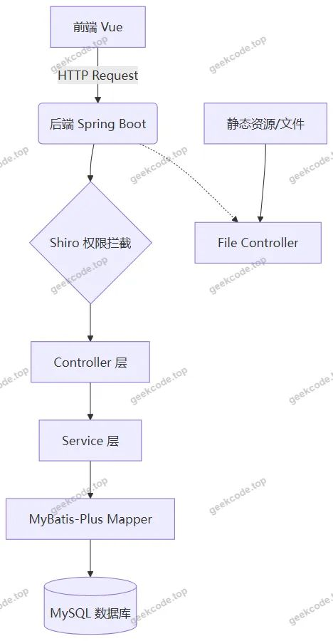</a>

<h2>功能模块</h2>
<h3>前台用户端</h3>
<ol>
<li><strong>首页展示</strong>：呈现系统主要入口及最新公告信息。</li>
<li><strong>登录与注册</strong>：提供用户身份验证及新账号创建功能。</li>
<li><strong>课程表查看</strong>：展示个人课表安排，支持详情查询。</li>
<li><strong>论坛交流</strong>：浏览帖子列表，查看帖子详情，参与社区讨论。</li>
<li><strong>学校公告</strong>：查看官方发布的各类通知与信息。</li>
<li><strong>个人中心</strong>：管理个人信息，查看“我的发布”内容及“我的收藏”列表。</li>
<li><strong>班级与教师信息</strong>：浏览班级列表及教师简介。</li>
<li><strong>课程分类与信息</strong>：按类别筛选课程，查看具体课程详细信息。</li>
<li><strong>请假管理</strong>：提交请假申请并查看请假信息记录。</li>
<li><strong>上课签到</strong>：执行课堂签到操作，查看签到详情。</li>
<li><strong>作业管理</strong>：查看作业信息列表及相关要求。</li>
</ol>
<h3>后台管理端</h3>
<ol>
<li><strong>系统配置</strong>：修改网站基本参数及配置文件。</li>
<li><strong>用户管理</strong>：对学生（xuesheng）和教师（jiaoshi）信息进行增删改查。</li>
<li><strong>班级管理</strong>：维护班级基础数据（banji）。</li>
<li><strong>课程管理</strong>：<ul>
<li>课程分类（kechengfenlei）：设置课程所属类别。</li>
<li>课程信息（kechengxinxi）：录入和管理课程详情。</li>
<li>课程表（kechengbiao）：排课及管理课表数据。</li>
</ul>
</li>
<li><strong>教学互动管理</strong>：<ul>
<li>论坛交流（forum）：审核帖子、回复及删除违规内容。</li>
<li>师生聊天（chat）：监控聊天记录及处理异常消息。</li>
</ul>
</li>
<li><strong>日常事务管理</strong>：<ul>
<li>学校公告（news）：发布、编辑及删除通知公告。</li>
<li>请假信息（qingjiaxinxi）：审批学生请假申请。</li>
<li>上课签到（shangkeqiandao）：查看签到统计及处理补签请求。</li>
<li>作业信息（zuoyexinxi）：发布作业、查看提交情况及评分。</li>
</ul>
</li>
</ol>
<h2>用户角色与权限</h2>

系统依据 Shiro 框架定义了三类主要角色，各角色拥有不同的功能访问权限：

<ol>
<li>
<strong>管理员（Admin）</strong>

<ul>
<li><strong>权限范围</strong>：拥有系统最高权限。</li>
<li><strong>可访问模块</strong>：所有后台路由对应的功能，包括但不限于学生管理、教师管理、班级管理、课程全生命周期管理（分类、信息、课表）、公告发布、论坛监管、聊天监控、请假审批、签到管理及作业管理。同时具备系统配置文件的修改权限。</li>
</ul>
</li>
<li>
<strong>教师（Teacher）</strong>

<ul>
<li><strong>权限范围</strong>：侧重于教学内容的发布与管理。</li>
<li><strong>可访问模块</strong>：</li>
<li><strong>后台部分</strong>：根据常规教务逻辑，教师通常需通过后台接口发布作业（zuoyexinxi）、查看所授课程的签到情况（shangkeqiandao）、管理自己发布的课程信息及回答论坛提问。<em>注：具体后台菜单可见性取决于 Shiro 的角色映射配置，但功能上支持上述操作。</em></li>
<li><strong>前台部分</strong>：查看所有公共信息（公告、课程表、论坛），管理个人资料，查看自己的发布内容。</li>
</ul>
</li>
<li>
<strong>学生（Student）</strong>

<ul>
<li><strong>权限范围</strong>：侧重于学习任务的接收与反馈。</li>
<li><strong>可访问模块</strong>：</li>
<li><strong>前台部分</strong>：完整的前台功能，包括查看课程表、浏览公告、参与论坛交流、查看课程信息、提交请假申请、执行上课签到、查看作业要求。</li>
<li><strong>个人中心</strong>：管理个人信息，查看自己的发帖记录和收藏内容。</li>
<li><strong>受限操作</strong>：无法进入后台管理页面，无权修改课程信息、发布全局公告或管理其他用户数据。</li>
</ul>
</li>
</ol>
<h2>项目特色与创新点</h2>
<ol>
<li><strong>全流程教学闭环</strong>：系统不仅包含传统的课程展示，还深度集成了“请假-审批”、“签到-统计”、“作业-发布”以及“师生即时聊天”等功能，形成了从课前准备到课后反馈的完整数字化教学闭环。</li>
<li><strong>多维互动社区</strong>：除了正式的教务管理，引入了“论坛交流”和“师生聊天”模块，增强了非正式场景下的师生互动频率，有助于营造活跃的在线学习氛围。</li>
<li><strong>细粒度权限控制</strong>：基于 Shiro 实现了严格的角色隔离，确保数据安全性。例如，只有管理员可以删除论坛帖子或修改系统配置，而普通用户只能进行读写操作，有效防止越权访问。</li>
<li><strong>模块化架构设计</strong>：后端 Controller 划分清晰（如 BanjiController, ChatController 等），每个业务域独立封装，便于后续功能的扩展与维护，符合高内聚低耦合的设计原则。</li>
</ol>
<h2>部署环境</h2>

为确保疫情网课管理系统正常运行，需准备以下软件环境：

<ol>
<li><strong>操作系统</strong>：Windows 10/11 或 Linux (CentOS 7+, Ubuntu 20.04+)。</li>
<li><strong>Java 运行环境</strong>：JDK 1.8 或更高版本（推荐 JDK 1.8 LTS）。</li>
<li><strong>数据库</strong>：MySQL 5.7 或 MySQL 8.0，需启用 InnoDB 引擎以支持事务处理。</li>
<li><strong>构建工具</strong>：Maven 3.6+，用于依赖管理和项目打包。</li>
<li><strong>前端环境</strong>：Node.js (建议 v14 或 v16 LTS)，npm/yarn 包管理器，用于编译 Vue 前端代码。</li>
<li><strong>Web 服务器</strong>：内置 Tomcat (Spring Boot 自带) 或 Nginx (用于生产环境反向代理)。</li>
<li><strong>浏览器</strong>：Chrome, Edge, Firefox 等现代主流浏览器，以兼容前端 Vue 渲染需求。</li>
</ol>
<h2>五、技术特性</h2>
<ul>
<li>前后端集成部署，前端资源打包至后端 static 目录</li>
<li>使用 MyBatis-Plus 简化数据访问层开发</li>
<li>集成 Shiro 权限框架实现角色权限控制</li>
</ul>
<h2>六、功能模块截图</h2>
<h3>前台用户端</h3>
<h4>前台首页</h4>

<a href="https://geekcode.top/archives/%E7%96%AB%E6%83%85%E7%BD%91%E8%AF%BE%E7%AE%A1%E7%90%86%E7%B3%BB%E7%BB%9F?utm_source=github" title="查看完整源码">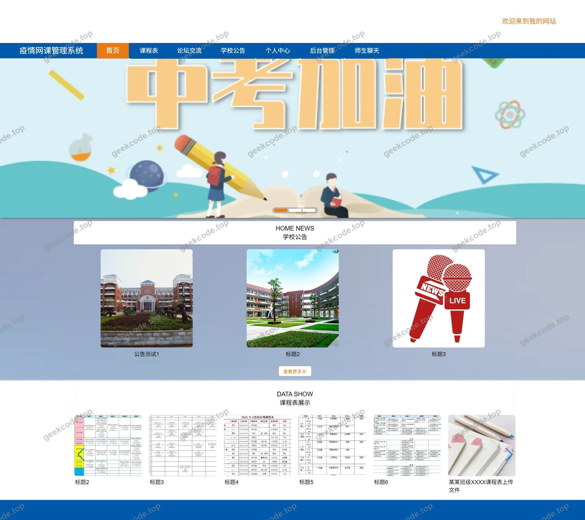</a>

<h4>前台登录页</h4>

<a href="https://geekcode.top/archives/%E7%96%AB%E6%83%85%E7%BD%91%E8%AF%BE%E7%AE%A1%E7%90%86%E7%B3%BB%E7%BB%9F?utm_source=github" title="查看完整源码">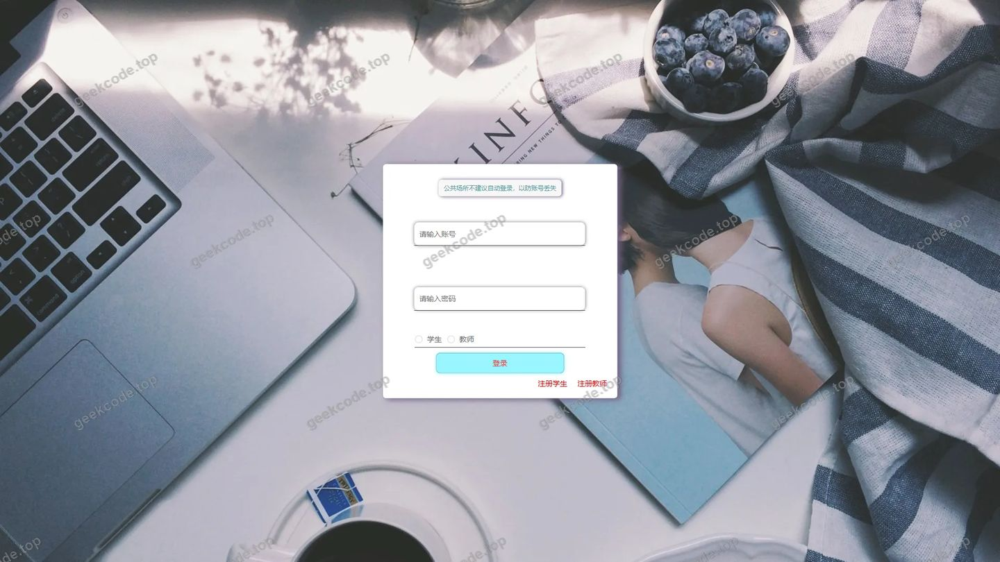</a>

<h4>前台注册页</h4>

<a href="https://geekcode.top/archives/%E7%96%AB%E6%83%85%E7%BD%91%E8%AF%BE%E7%AE%A1%E7%90%86%E7%B3%BB%E7%BB%9F?utm_source=github" title="查看完整源码">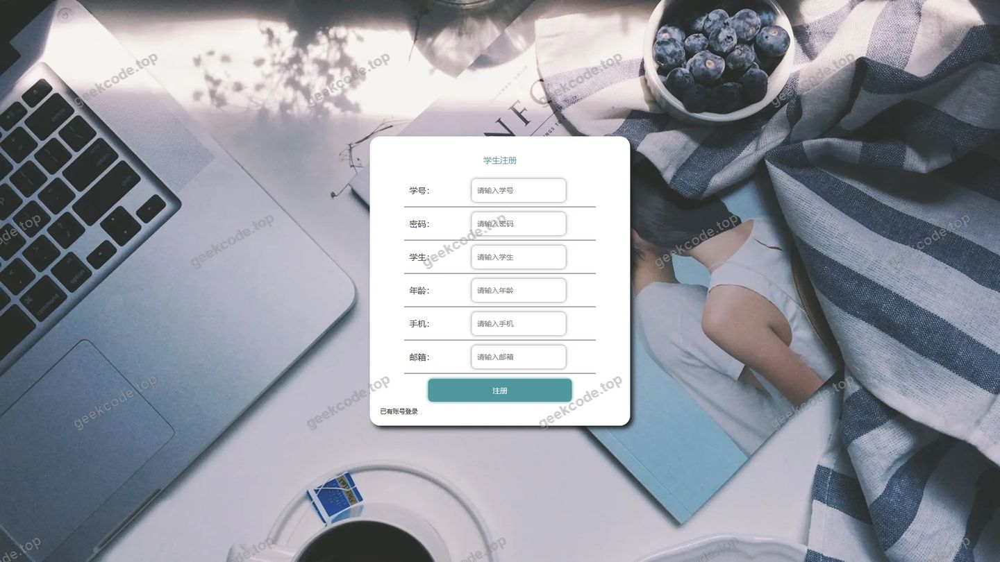</a>

<h4>前台-论坛交流列表</h4>

<a href="https://geekcode.top/archives/%E7%96%AB%E6%83%85%E7%BD%91%E8%AF%BE%E7%AE%A1%E7%90%86%E7%B3%BB%E7%BB%9F?utm_source=github" title="查看完整源码">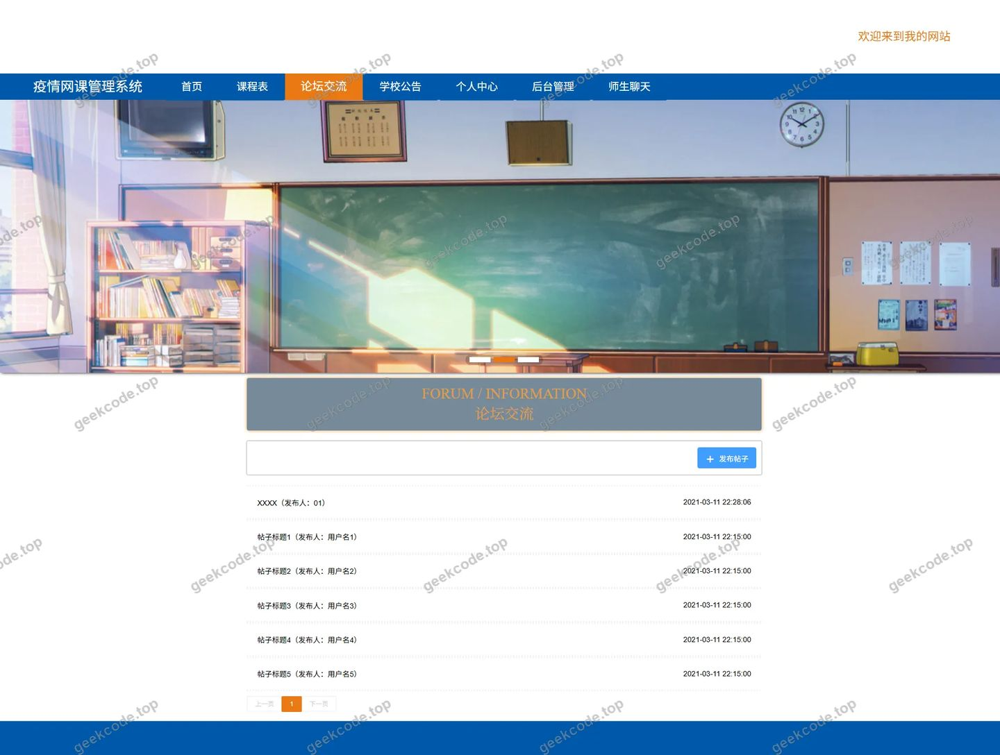</a>

<h4>前台-课程表列表</h4>

<a href="https://geekcode.top/archives/%E7%96%AB%E6%83%85%E7%BD%91%E8%AF%BE%E7%AE%A1%E7%90%86%E7%B3%BB%E7%BB%9F?utm_source=github" title="查看完整源码">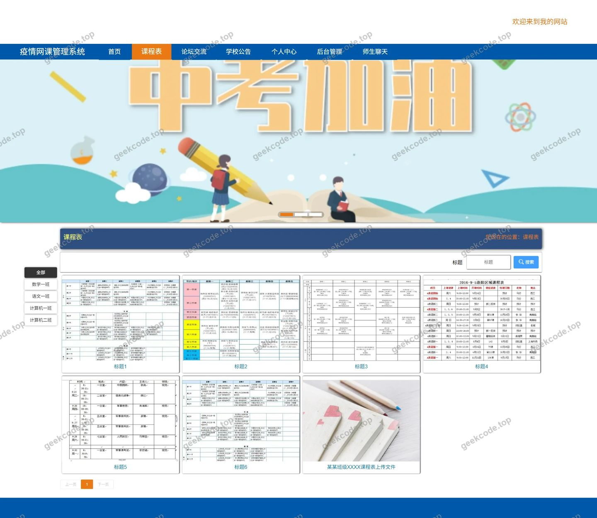</a>

<h4>前台-学校公告列表</h4>

<a href="https://geekcode.top/archives/%E7%96%AB%E6%83%85%E7%BD%91%E8%AF%BE%E7%AE%A1%E7%90%86%E7%B3%BB%E7%BB%9F?utm_source=github" title="查看完整源码">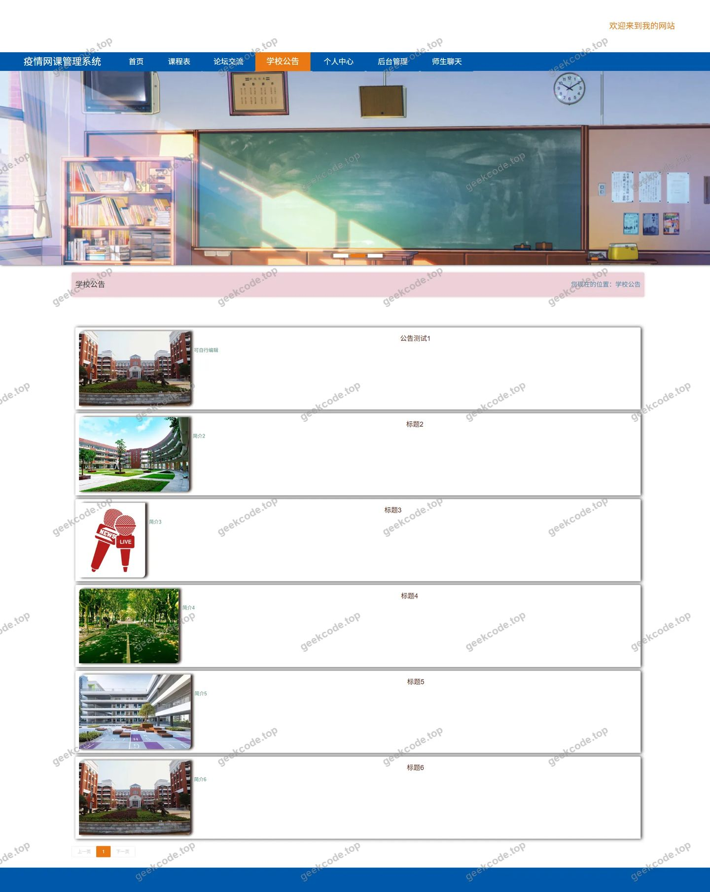</a>

<h4>前台个人中心</h4>

<a href="https://geekcode.top/archives/%E7%96%AB%E6%83%85%E7%BD%91%E8%AF%BE%E7%AE%A1%E7%90%86%E7%B3%BB%E7%BB%9F?utm_source=github" title="查看完整源码">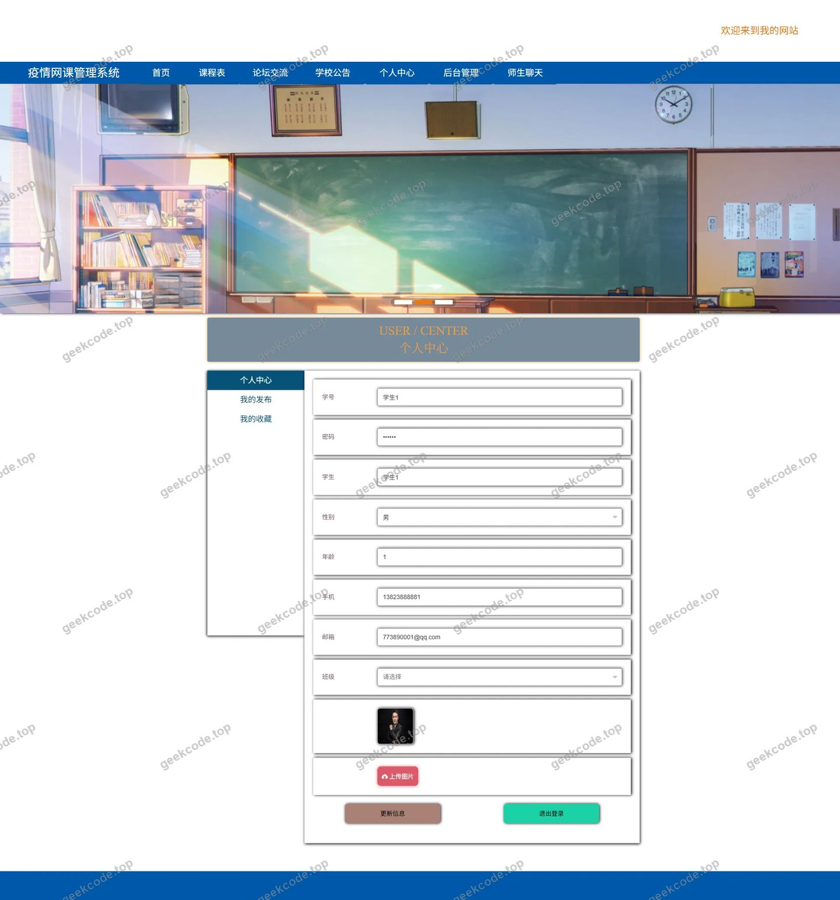</a>

<h4>前台-我的收藏列表</h4>

<a href="https://geekcode.top/archives/%E7%96%AB%E6%83%85%E7%BD%91%E8%AF%BE%E7%AE%A1%E7%90%86%E7%B3%BB%E7%BB%9F?utm_source=github" title="查看完整源码">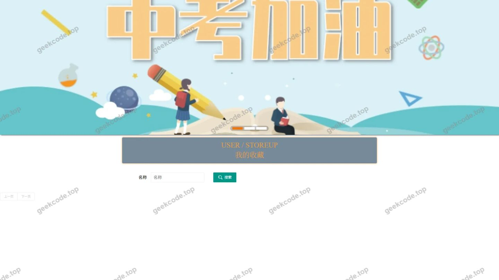</a>

<h4>前台-论坛交流-详情</h4>

<a href="https://geekcode.top/archives/%E7%96%AB%E6%83%85%E7%BD%91%E8%AF%BE%E7%AE%A1%E7%90%86%E7%B3%BB%E7%BB%9F?utm_source=github" title="查看完整源码">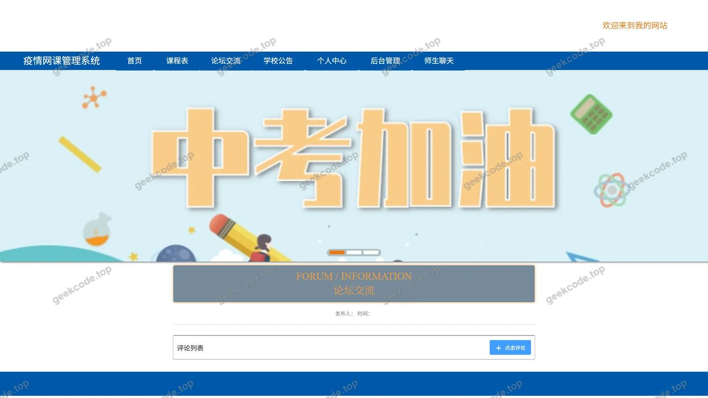</a>

<h4>前台-课程表-详情</h4>

<a href="https://geekcode.top/archives/%E7%96%AB%E6%83%85%E7%BD%91%E8%AF%BE%E7%AE%A1%E7%90%86%E7%B3%BB%E7%BB%9F?utm_source=github" title="查看完整源码">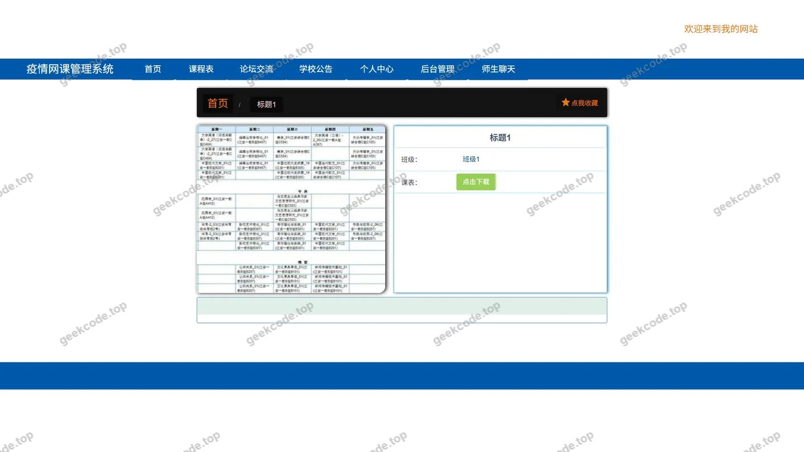</a>

<h4>前台-学校公告-详情</h4>

<a href="https://geekcode.top/archives/%E7%96%AB%E6%83%85%E7%BD%91%E8%AF%BE%E7%AE%A1%E7%90%86%E7%B3%BB%E7%BB%9F?utm_source=github" title="查看完整源码">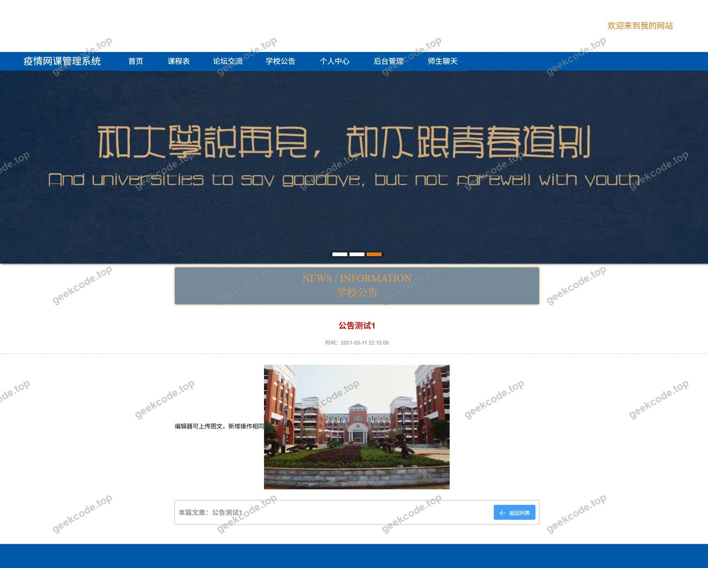</a>

<h4>前台-班级列表</h4>

<h4>前台-教师列表</h4>

<h4>前台-课程分类列表</h4>

<h4>前台-课程信息列表</h4>

<h4>前台-请假信息列表</h4>

<a href="https://geekcode.top/archives/%E7%96%AB%E6%83%85%E7%BD%91%E8%AF%BE%E7%AE%A1%E7%90%86%E7%B3%BB%E7%BB%9F?utm_source=github" title="查看完整源码">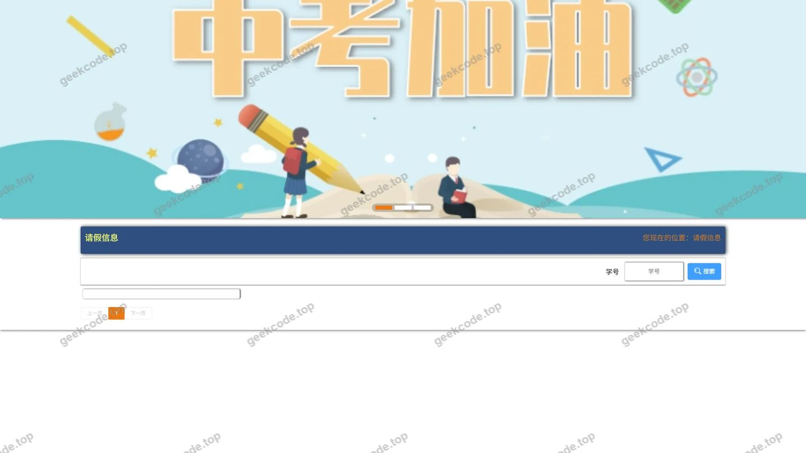</a>

<h4>前台-上课签到列表</h4>

<h4>前台-作业信息列表</h4>

<h4>前台-上课签到-详情</h4>

<a href="https://geekcode.top/archives/%E7%96%AB%E6%83%85%E7%BD%91%E8%AF%BE%E7%AE%A1%E7%90%86%E7%B3%BB%E7%BB%9F?utm_source=github" title="查看完整源码">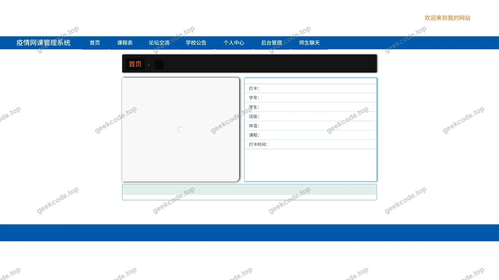</a>

<h3>后台管理端</h3>
<h4>后台-班级</h4>

<a href="https://geekcode.top/archives/%E7%96%AB%E6%83%85%E7%BD%91%E8%AF%BE%E7%AE%A1%E7%90%86%E7%B3%BB%E7%BB%9F?utm_source=github" title="查看完整源码">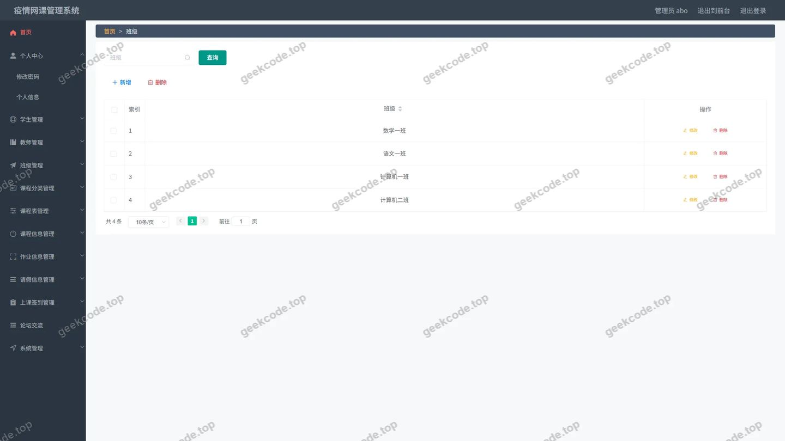</a>

<h4>后台-在线客服</h4>

<a href="https://geekcode.top/archives/%E7%96%AB%E6%83%85%E7%BD%91%E8%AF%BE%E7%AE%A1%E7%90%86%E7%B3%BB%E7%BB%9F?utm_source=github" title="查看完整源码">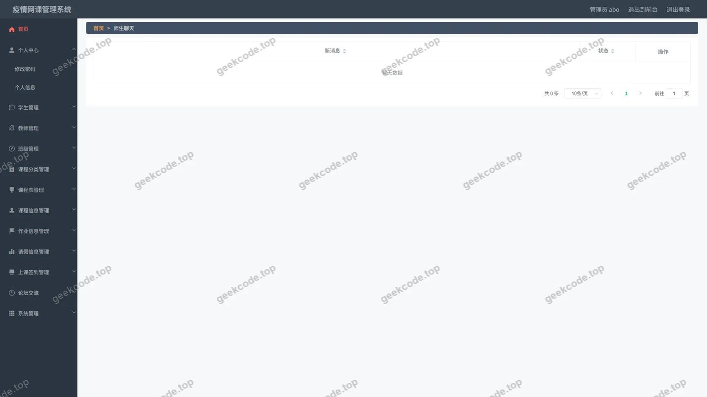</a>

<h4>后台-系统配置</h4>

<a href="https://geekcode.top/archives/%E7%96%AB%E6%83%85%E7%BD%91%E8%AF%BE%E7%AE%A1%E7%90%86%E7%B3%BB%E7%BB%9F?utm_source=github" title="查看完整源码">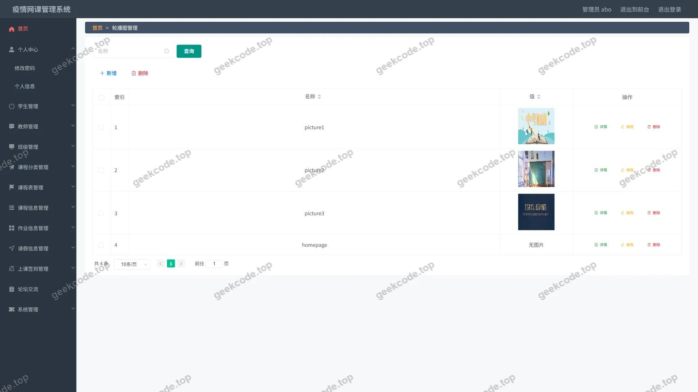</a>

<h4>后台-论坛</h4>

<a href="https://geekcode.top/archives/%E7%96%AB%E6%83%85%E7%BD%91%E8%AF%BE%E7%AE%A1%E7%90%86%E7%B3%BB%E7%BB%9F?utm_source=github" title="查看完整源码">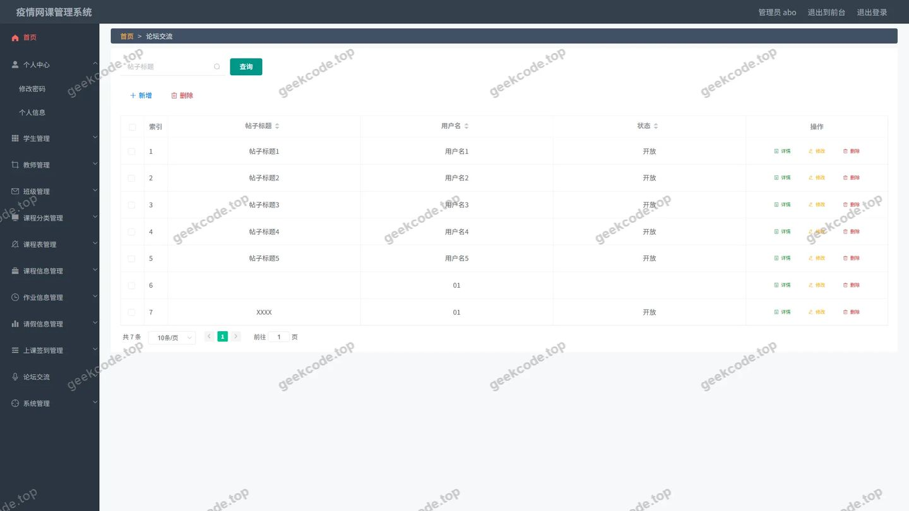</a>

<h4>后台首页</h4>

<a href="https://geekcode.top/archives/%E7%96%AB%E6%83%85%E7%BD%91%E8%AF%BE%E7%AE%A1%E7%90%86%E7%B3%BB%E7%BB%9F?utm_source=github" title="查看完整源码">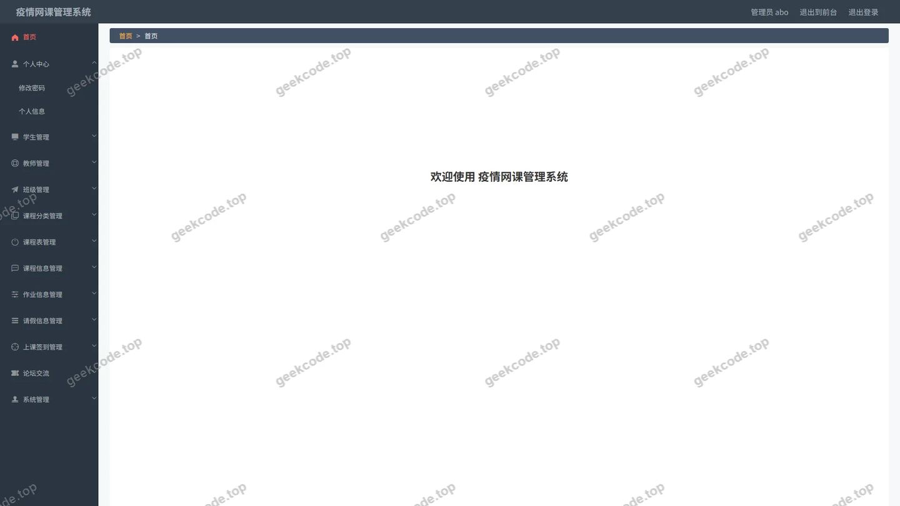</a>

<h4>后台-教师</h4>

<a href="https://geekcode.top/archives/%E7%96%AB%E6%83%85%E7%BD%91%E8%AF%BE%E7%AE%A1%E7%90%86%E7%B3%BB%E7%BB%9F?utm_source=github" title="查看完整源码">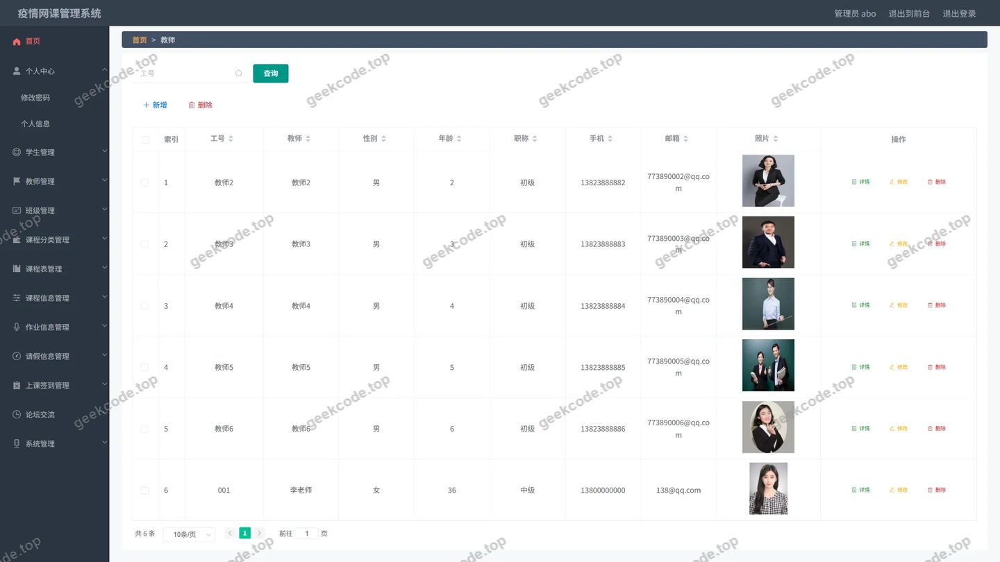</a>

<h4>后台-课程</h4>

<a href="https://geekcode.top/archives/%E7%96%AB%E6%83%85%E7%BD%91%E8%AF%BE%E7%AE%A1%E7%90%86%E7%B3%BB%E7%BB%9F?utm_source=github" title="查看完整源码">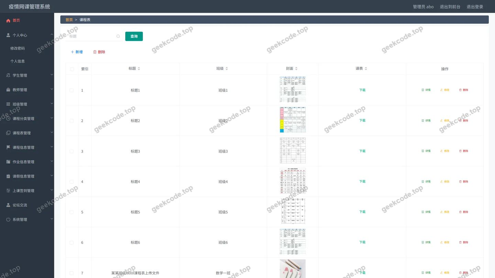</a>

<h4>后台-课程分类</h4>

<a href="https://geekcode.top/archives/%E7%96%AB%E6%83%85%E7%BD%91%E8%AF%BE%E7%AE%A1%E7%90%86%E7%B3%BB%E7%BB%9F?utm_source=github" title="查看完整源码">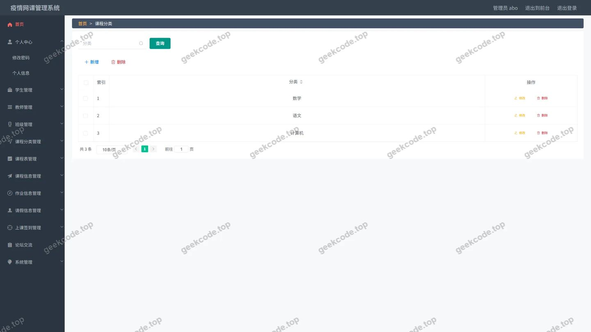</a>

<h4>后台-课程信息</h4>

<h4>后台-登录</h4>

<h4>后台-公告信息</h4>

<a href="https://geekcode.top/archives/%E7%96%AB%E6%83%85%E7%BD%91%E8%AF%BE%E7%AE%A1%E7%90%86%E7%B3%BB%E7%BB%9F?utm_source=github" title="查看完整源码">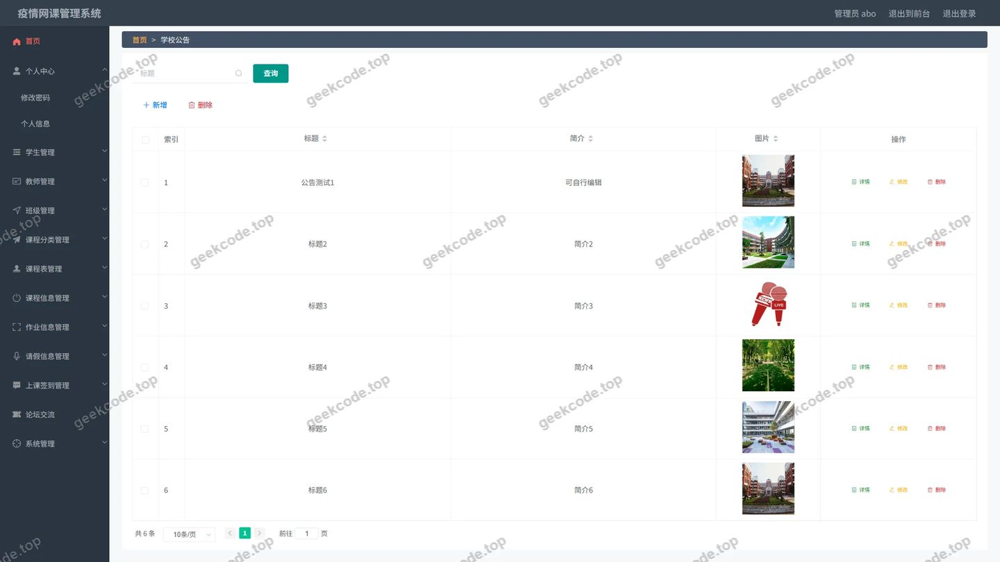</a>

<h4>后台-请假信息</h4>

<a href="https://geekcode.top/archives/%E7%96%AB%E6%83%85%E7%BD%91%E8%AF%BE%E7%AE%A1%E7%90%86%E7%B3%BB%E7%BB%9F?utm_source=github" title="查看完整源码">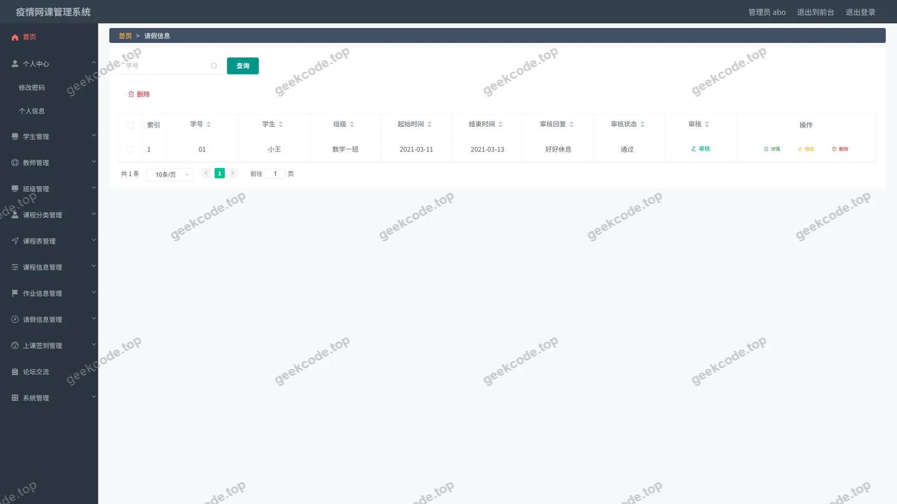</a>

<h4>后台-上课签到</h4>

<a href="https://geekcode.top/archives/%E7%96%AB%E6%83%85%E7%BD%91%E8%AF%BE%E7%AE%A1%E7%90%86%E7%B3%BB%E7%BB%9F?utm_source=github" title="查看完整源码">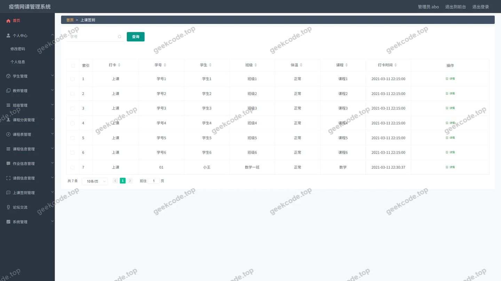</a>

<h4>后台-学生</h4>

<a href="https://geekcode.top/archives/%E7%96%AB%E6%83%85%E7%BD%91%E8%AF%BE%E7%AE%A1%E7%90%86%E7%B3%BB%E7%BB%9F?utm_source=github" title="查看完整源码">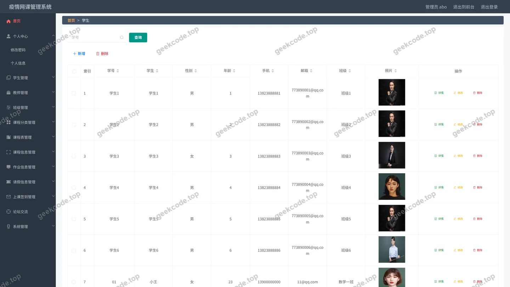</a>

<h4>后台-作业信息</h4>

<a href="https://geekcode.top/archives/%E7%96%AB%E6%83%85%E7%BD%91%E8%AF%BE%E7%AE%A1%E7%90%86%E7%B3%BB%E7%BB%9F?utm_source=github" title="查看完整源码">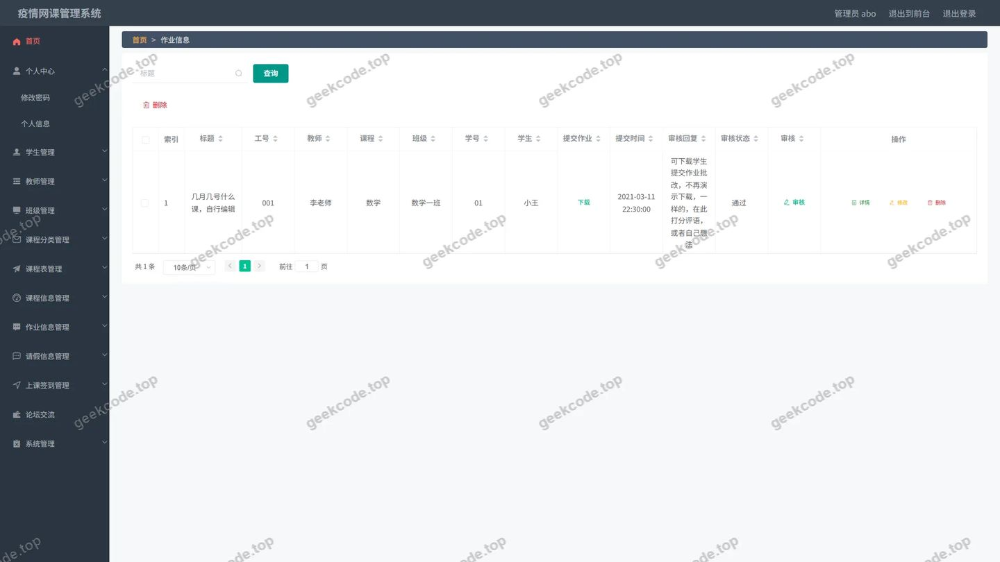</a>

---

## 获取完整源码

| 项目 | 说明 |
| --- | --- |
| 项目名 | 疫情网课管理系统 |
| 运行截图 | 本文 35 张（站点带水印原图，仓库 `images/` 目录） |
| 完整源码 | [https://geekcode.top/archives/%E7%96%AB%E6%83%85%E7%BD%91%E8%AF%BE%E7%AE%A1%E7%90%86%E7%B3%BB%E7%BB%9F?utm_source=github](https://geekcode.top/archives/%E7%96%AB%E6%83%85%E7%BD%91%E8%AF%BE%E7%AE%A1%E7%90%86%E7%B3%BB%E7%BB%9F?utm_source=github) |
| 咨询微信 | **ir9372**（备注：jingpin-yuanma） |
| 更多项目 | [极客代码 geekcode.top](https://geekcode.top/?utm_source=github) |

> 需要源码、部署、改配置、跑不起来等问题，加微信 ir9372 沟通，说明项目名即可。
